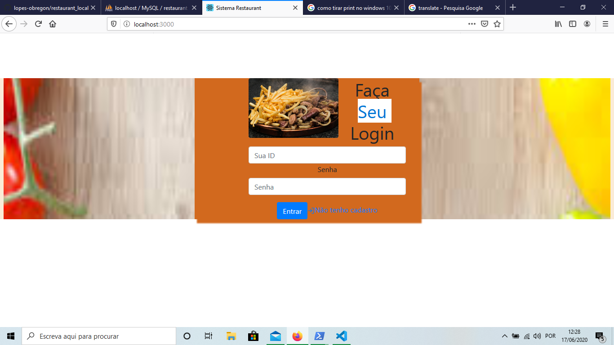
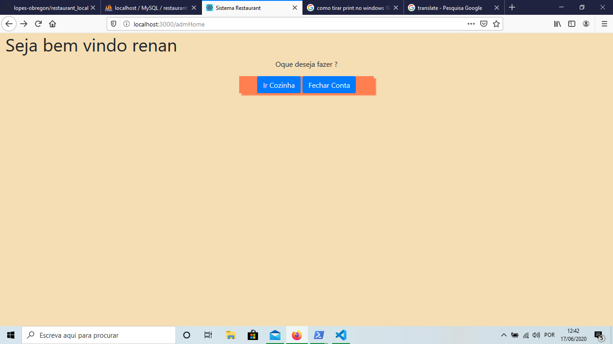
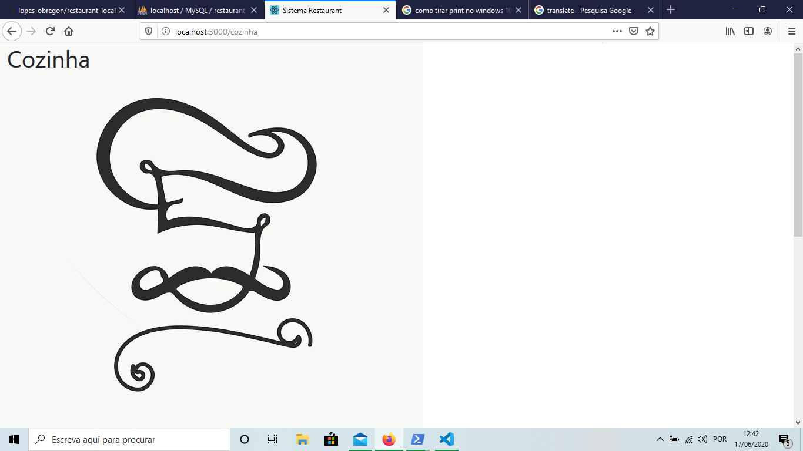
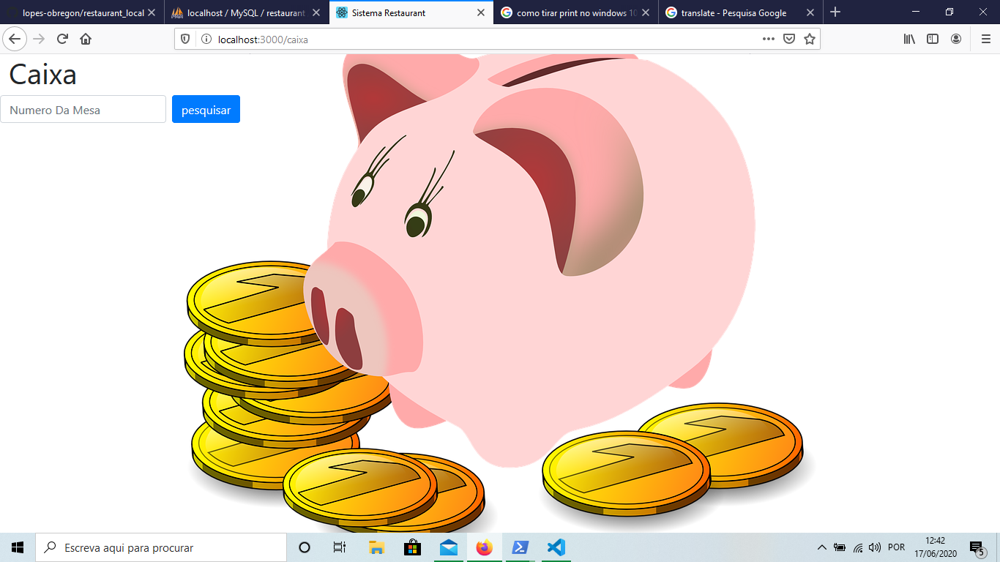
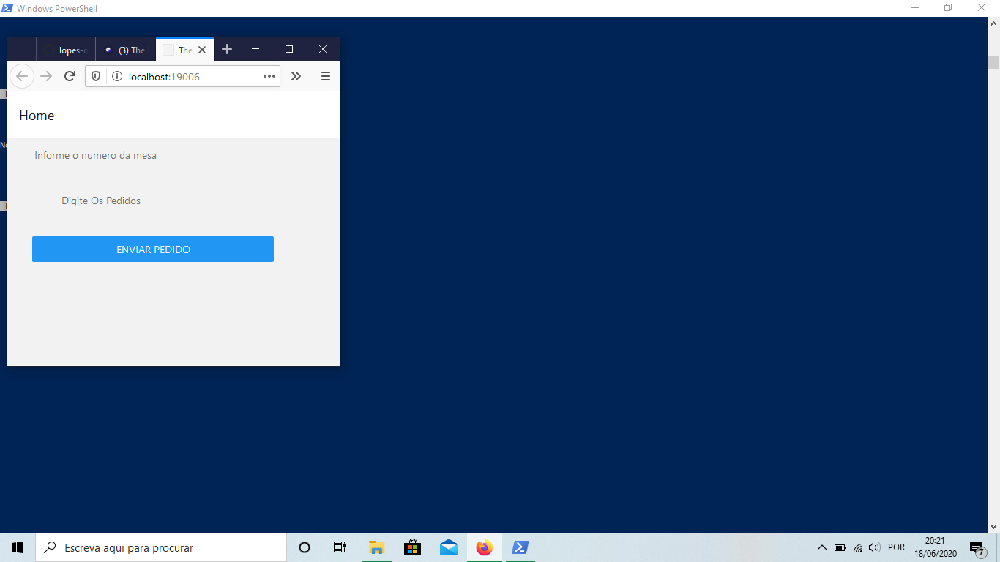

# 🍽️ restaurant_local: Comprehensive Restaurant Management System

[](https://github.com/lopes-obregon/restaurant_local/commits/main)
[](https://github.com/lopes-obregon/restaurant_local)
[](https://opensource.org/licenses/MIT)

---

## 📦 Overview

`restaurant_local` is a robust, full-stack application designed to **streamline and automate core operations within a restaurant environment**. This system provides distinct, role-based interfaces for administrators, kitchen staff, and cashiers, ensuring efficient management of products, orders, and user access. Leveraging a responsive design, it also offers a mobile-optimized view for customers or table-side interactions.

---

## 🚀 Key Features

* **Product Management:** Seamlessly add, remove, and update product details through intuitive front-end and back-end interfaces.
* **Order & Delivery Workflow:** Efficiently manage incoming orders, update their status (e.g., in preparation, ready for delivery/pickup), and track completion.
* **User Authentication & Access Control:** Secure login system with role-based access to ensure authorized personnel can access specific functionalities.
* **Admin Panel:** A dedicated interface for administrators to manage users (add, edit, delete) and oversee product inventory.
* **Kitchen Display System (KDS):** A specialized screen for kitchen staff to view new and active orders, facilitating timely preparation and status updates.
* **Cashier Interface:** A dedicated module for cashiers to view active orders, process payments, and close completed transactions efficiently.
* **Mobile-Optimized Interface:** A responsive layout designed for mobile devices, suitable for customer order viewing or table-side operations.

---

## 🖥️ Screen Previews

Explore the key interfaces of the `restaurant_local` system.
*(**Important:** Replace these placeholders with actual screenshots or GIFs for maximum impact. This is crucial for UI-based projects.)*

* **Login Interface** – User authentication portal for all roles.
   

* **Admin Dashboard** – Centralized panel for product and user management.
    * 
    
* **Kitchen View** – Real-time display of incoming orders and delivery status updates.
      
* **Cashier Terminal** – Overview of active orders and transaction finalization.
    
* **Mobile Interface** – Responsive layout showcasing the system's adaptability on smaller screens.
      

---

## 🧰 Technologies Used

The `restaurant_local` system is built using a modern stack to ensure robust performance and maintainability:

* **Frontend:**
    * `HTML5`
    * `CSS3`
    * `JavaScript`
* **Backend:**
    * `Node.js`
    * `Express.js` (Presumed, as typical for Node.js backends for API creation)
* **Database:**
    * `MySQL`

---

## 🗄️ Database Schema

The system's data is structured across three primary tables within the `restaurant` database:

**Database Name:** `restaurant`

| Table Name  | Column Name     | Description                                |
| :---------- | :-------------- | :----------------------------------------- |
| `adms`      | `id`            | Unique identifier for administrators (Primary Key) |
|             | `user`          | Administrator's username                  |
|             | `password`      | Administrator's hashed password           |
| `pedidos`   | `id`            | Unique identifier for orders (Primary Key) |
|             | `pedido`        | Details of the order (e.g., JSON string of items) |
|             | `pedido_entregue`| Boolean indicating if the order has been delivered |
|             | `mesa_ou_nome`  | Table number or customer name for the order |
| `produtos`  | `id`            | Unique identifier for products (Primary Key) |
|             | `nomeProduto`   | Name of the product                       |
|             | `valor`         | Price of the product                      |

---

## 🛠️ Setup and Installation

Follow these steps to get the `restaurant_local` system up and running on your local machine.

**Prerequisites:**
Ensure you have the following installed:
* [Node.js](https://nodejs.org/) (LTS version recommended)
* [MySQL Server](https://dev.mysql.com/downloads/mysql/)

**Instructions:**

1.  **Clone the repository:**
    ```bash
    git clone [https://github.com/lopes-obregon/restaurant_local.git](https://github.com/lopes-obregon/restaurant_local.git)
    cd restaurant_local
    ```

2.  **Database Setup:**
    * Open your MySQL client (e.g., MySQL Workbench, command line).
    * Create the database:
        ```sql
        CREATE DATABASE restaurant;
        USE restaurant;
        ```
    * Create the tables (you'll need to define the full `CREATE TABLE` statements for `adms`, `pedidos`, and `produtos` with appropriate data types in a `.sql` file, or include them here, or provide a link to them):
        ```sql
        -- Example for adms table (you'll need to complete this)
        CREATE TABLE adms (
            id INT AUTO_INCREMENT PRIMARY KEY,
            user VARCHAR(255) NOT NULL UNIQUE,
            password VARCHAR(255) NOT NULL
        );
        -- ... and similarly for 'pedidos' and 'produtos'
        ```
    * *(**Recommendation:** Include a `database.sql` file in your repository with the full `CREATE TABLE` and initial `INSERT` statements for easier setup.)*

3.  **Backend Setup:**
    ```bash
    # Navigate to the backend folder
    cd backend
    # Install dependencies
    npm install
    # Start the backend server
    npm start
    ```
    The backend server should now be running, typically on `http://localhost:3000` (or as configured).

4.  **Frontend Setup:**
    The frontend (HTML, CSS, JavaScript) will typically be served by the backend or opened directly in a browser if it's purely static.
    * Navigate to your frontend project directory if it's separate: `cd ../frontend` (adjust path if needed).
    * Open the `index.html` file in your web browser. *(Adjust this instruction if your frontend is served by a dev server or build process).*

---

## 👥 Contributors

* [**Lopes Obregon**](https://github.com/lopes-obregon) - Main Developer

---

## 📄 License

This project is licensed under the **MIT License** - see the [LICENSE](LICENSE) file for details.

---

**Remember to:**

1.  **Create a `LICENSE` file:** In the root of your `restaurant_local` repository, create a plain text file named `LICENSE` (no extension) and paste the full MIT License text into it.
2.  **Add your screenshots/GIFs:** Create an `assets` folder (or similar) in your repository and place your `login_screen.png`, `admin_screen.png`, etc., inside it. Update the image paths in the README. Visuals are key!
3.  **Provide `CREATE TABLE` SQL scripts:** It's highly recommended to include a `.sql` file (e.g., `database.sql`) in your repository's root or a `db` folder that contains all the SQL commands needed to create your `restaurant` database and its tables. This makes setup much easier for others.
4.  **Specify Backend Port:** If your Node.js backend runs on a specific port (e.g., 3000, 8080), mention it in the setup instructions.
5.  **Expand Backend Technologies:** If you use `Express.js`, `body-parser`, `cors`, etc., in your Node.js backend, you can briefly mention them under "Backend Technologies."

This revised README is comprehensive, professional, and provides clear guidance for anyone wanting to understand or run your project!
